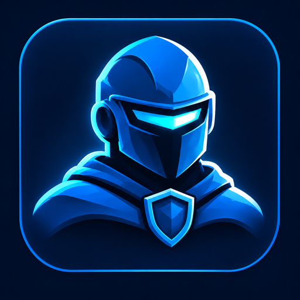
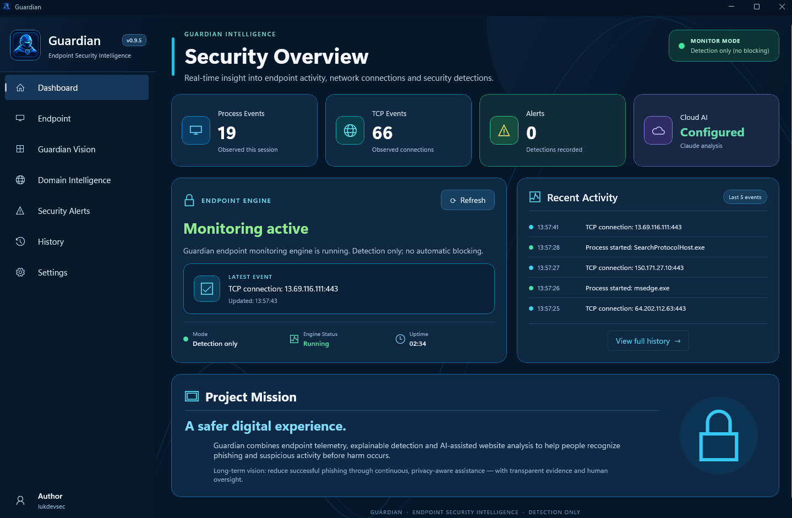
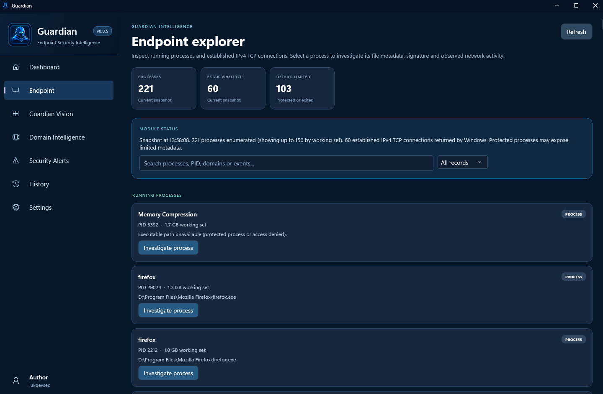
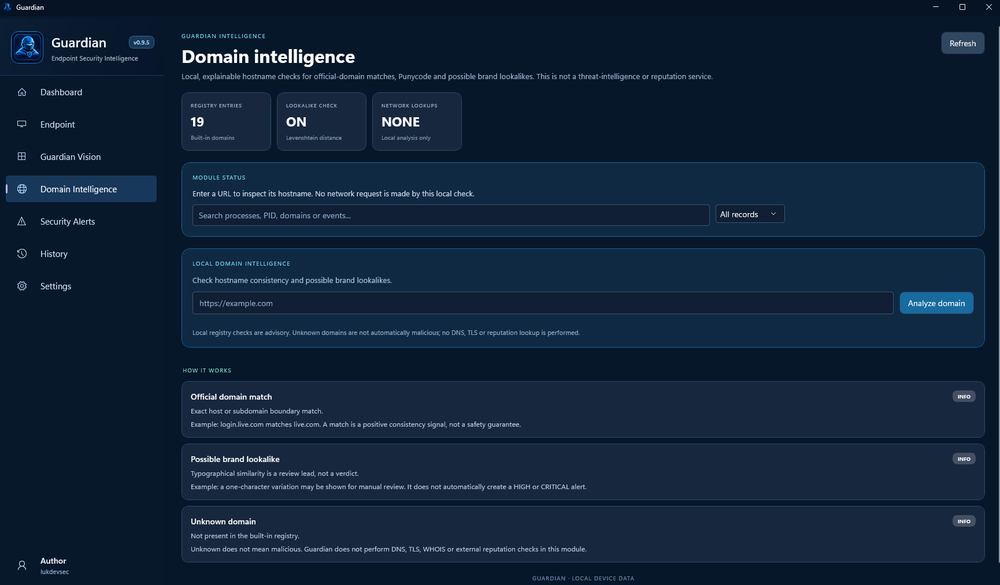
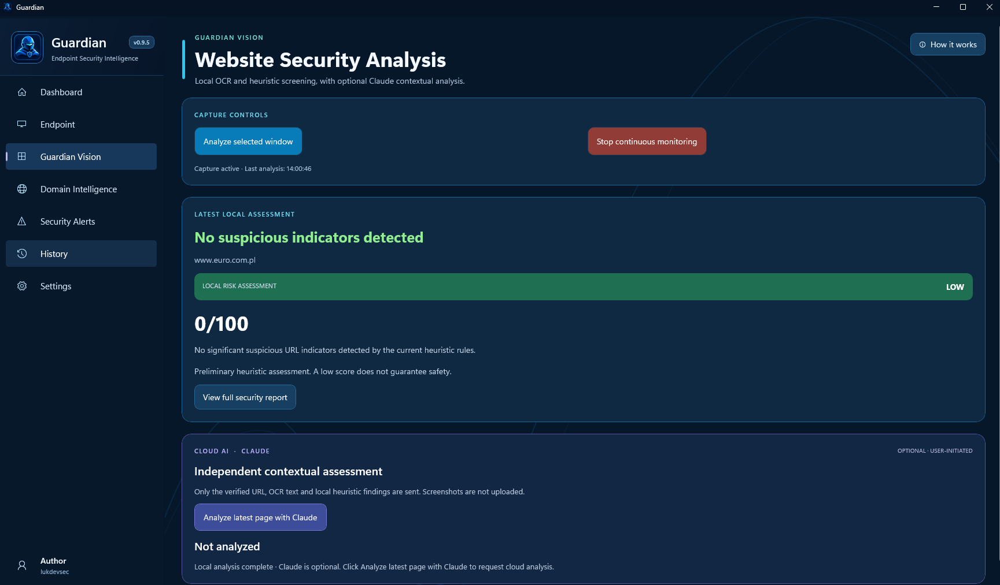
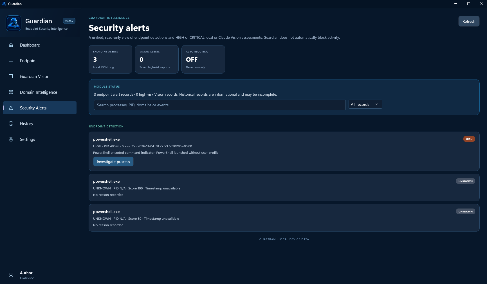
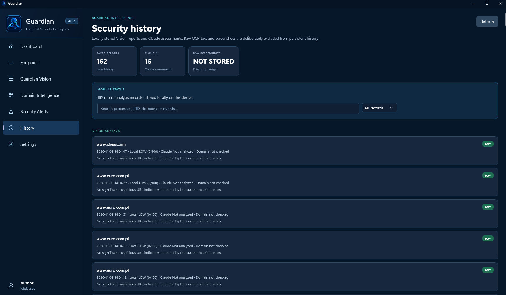
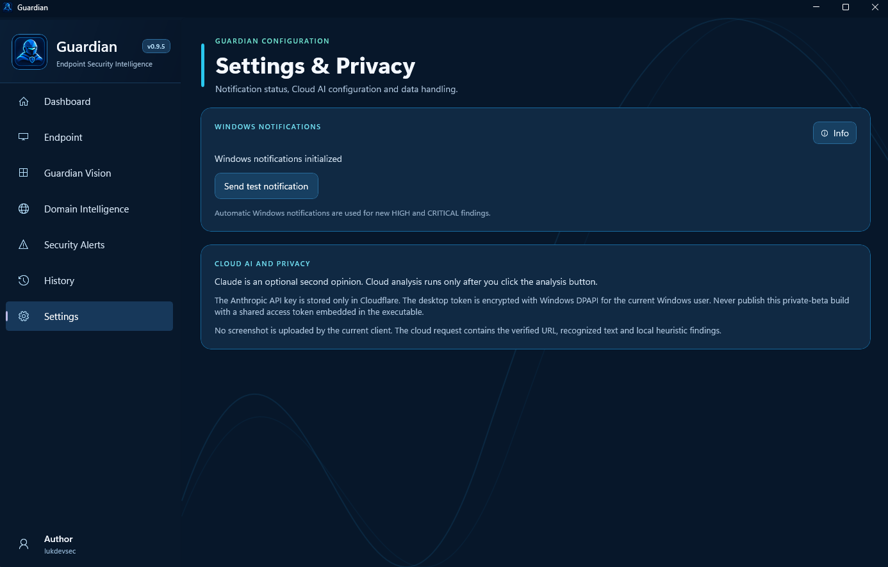
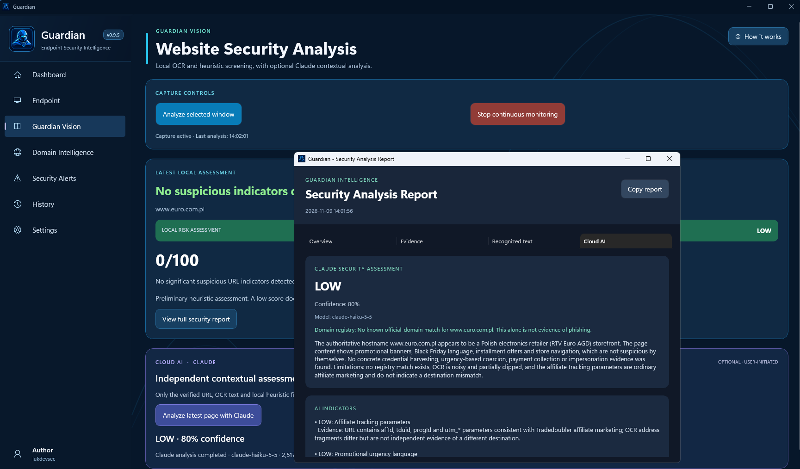

<div align="center">



# GUARDIAN

### Windows Security Monitoring Platform

Local endpoint monitoring, browser intelligence, OCR-based screen analysis and AI-assisted phishing assessment.

[](LICENSE)
[](https://www.microsoft.com/windows)
[](https://dotnet.microsoft.com/)
[](SECURITY.md)

**Developed by [lukdevsec](https://github.com/lukdevsec)**

</div>

---

[Overview](#overview) | [Screenshots](#screenshots) | [Features](#features) | [Architecture](#architecture) | [Technology Stack](#technology-stack) | [Installation](#development-setup) | [Security](#privacy-and-security)

---

## Overview

Guardian is a Windows security monitoring application designed to combine endpoint visibility, browser address intelligence, local screen analysis and optional cloud-assisted threat assessment in one desktop interface.

The project explores practical security engineering concepts, including Windows process monitoring, network connection visibility, OCR-based analysis, heuristic detection and secure handling of authentication credentials.

Guardian is an actively developed project. Its functionality and security controls continue to evolve.

## Screenshots

Explore the Guardian desktop interface and its main security modules.

### Security Dashboard



The main dashboard provides visibility into endpoint activity, process events, TCP connections, security alerts and monitoring status.

### Endpoint Explorer



Inspect running processes, established TCP connections and available process metadata.

### Domain Intelligence



Perform local hostname consistency checks and inspect potential brand lookalikes.

### Guardian Vision



Analyze selected screen content using OCR and local heuristic screening, with optional cloud-assisted assessment.

### Security Alerts



Review endpoint detections and high-risk Vision assessments in a unified interface.

### Security History



Review locally stored analysis metadata and historical security assessments.

### Settings & Privacy



Explore notification configuration, Cloud AI settings and privacy information.

### AI-Assisted Security Analysis



Review structured AI assessments, confidence indicators, evidence and recommended actions.

---
## Features

### Endpoint Monitoring

- Process inventory and process event monitoring.
- Visibility into established TCP connections.
- Endpoint telemetry collected through dedicated monitoring components.
- Recent activity and monitoring status presented in the desktop dashboard.

### Guardian Vision

- Screen capture and OCR-based text recognition.
- Browser address extraction and URL analysis.
- Local heuristic analysis of potentially suspicious content.
- User-initiated AI-assisted assessment through Guardian Cloud.

### Browser Intelligence

- Browser address-bar information extraction.
- URL and domain analysis.
- Official-domain consistency checks through a maintained domain registry.
- Separation of local heuristic findings from AI-generated assessments.

### Guardian Cloud

- Optional Cloudflare Workers backend.
- Anthropic API integration on the server side.
- Structured AI analysis responses.
- Server-side handling of the Anthropic API credential.

Cloud functionality is intended for controlled development and testing. The current shared bearer-token model is not suitable for unrestricted public distribution.

### Desktop Experience

- Windows desktop interface built with WinUI 3.
- Dedicated application pages and security dashboard.
- Local history and security event presentation.
- Windows notifications and application integration.

## Architecture

Guardian is organized into several .NET projects:

| Project | Responsibility |
|---|---|
| `Guardian.Core` | Core detection models and shared security logic |
| `Guardian.Monitoring` | Process and network monitoring |
| `Guardian.Service` | Background service and telemetry communication |
| `Guardian.Desktop` | WinUI 3 desktop application and user interface |
| `Guardian` | Additional Windows monitoring application project |

The solution also includes a Cloudflare Worker backend and Windows installer tooling.

### High-level data flow

```text
Windows Environment
        |
        v
Guardian Monitoring
        |
        v
Process and Network Telemetry
        |
        v
Guardian Desktop
        |
        +----------------------+
        |                      |
        v                      v
Local Vision Analysis     Local History
        |
        v
Browser URL + OCR Text
+ Heuristic Findings
        |
        v
User-Initiated Cloud Analysis
        |
        v
Cloudflare Worker
        |
        v
Anthropic API
        |
        v
Structured Assessment
        |
        v
Guardian Desktop
```

Cloud analysis is optional. Local monitoring and analysis are separate from the cloud-assisted workflow.

## Technology Stack

| Technology | Purpose |
|---|---|
| C# | Application development |
| .NET 10 | Runtime and application framework |
| WinUI 3 | Windows desktop interface |
| Windows App SDK | Windows application integration |
| Windows APIs | Process and network visibility |
| RapidOcrNet | OCR processing |
| ONNX Runtime | Machine learning inference |
| FlaUI | Windows UI automation |
| Cloudflare Workers | Cloud backend |
| Anthropic API | AI-assisted analysis |
| Inno Setup | Windows installer generation |

## Privacy and Security

Guardian is designed with a local-first approach for endpoint monitoring and screen analysis.

Current documented behavior:

- Screen analysis is initiated by the user.
- Cloud analysis sends the authoritative browser URL, OCR text and local heuristic findings.
- Screenshots are not uploaded to the Cloudflare Worker.
- Local history stores analysis metadata rather than raw screenshots or OCR content.
- The Guardian Cloud access token is stored locally using Windows DPAPI for the current Windows user.
- The Anthropic API key is configured as a Cloudflare Worker secret rather than embedded in the desktop source code.

**Important:** DPAPI protects stored credentials at rest. It does not make a shared credential safe to distribute inside a public application.

See [Privacy](docs/PRIVACY.md) and [Security Policy](SECURITY.md).


The local Guardian Cloud access token is stored at:

`%LOCALAPPDATA%\Guardian\cloud-access-token.bin`

It is protected using Windows DPAPI for the current Windows user.
## Development Setup

### Requirements

- Windows 10 version 2004 (build 19041) or newer.
- Windows 11 supported.
- Visual Studio with Windows desktop development support.
- .NET 10 SDK.
- Windows App SDK and Windows SDK tooling.
- Git.
- Internet access for NuGet dependency restoration.

### Clone the repository

```powershell
git clone https://github.com/lukdevsec/Guardian.git
cd Guardian
```

### Restore dependencies

```powershell
dotnet restore .Guardian.slnx
```

### Open the solution

Open:

```text
Guardian.slnx
```

in Visual Studio.

Set `Guardian.Desktop` as the startup project and select the appropriate Windows x64 configuration.

Build and run the solution from Visual Studio.

For additional instructions, see [Installation](docs/INSTALLATION.md).

## Cloud Backend

The Cloudflare Worker source is located in:

```text
Cloudflare/
    worker.js
    README.md
```

The backend expects two Cloudflare Secret bindings:

- `ANTHROPIC_API_KEY`
- `GUARDIAN_ACCESS_TOKEN`

Never commit these values to source control.

The currently documented shared bearer-token implementation is intended for a private development environment. Public multi-user distribution requires individual credentials, revocation, server-side rate limiting and usage quotas.

See the [Cloudflare documentation](Cloudflare/README.md).

## Project Structure

```text
Guardian/
|
+-- Guardian.Core/
+-- Guardian.Monitoring/
+-- Guardian.Service/
+-- Guardian.Desktop/
|   +-- Cloud/
|   +-- Domain/
|   +-- Endpoint/
|   +-- History/
|   +-- IPC/
|   +-- Notifications/
|   +-- Pages/
|   +-- Vision/
|   +-- Assets/
|
+-- Cloudflare/
+-- Installer/
|   +-- Assets/
|   +-- IdentityPackage/
|   +-- Scripts/
|
+-- Scripts/
+-- docs/
+-- screenshots/
|
+-- LICENSE
+-- THIRD-PARTY-NOTICES.md
+-- SECURITY.md
+-- CONTRIBUTING.md
+-- Guardian.slnx
+-- README.md
```

## Product Showcase

A full product demonstration video is planned.

The showcase will demonstrate Guardian Dashboard, Endpoint Monitoring, Domain Intelligence, Guardian Vision and AI-assisted security analysis.

**Video coming soon.**

---

## Roadmap

Planned areas of continued development:

- Strengthen endpoint monitoring and telemetry reliability.
- Expand local detection and analysis capabilities.
- Improve browser address intelligence.
- Improve Guardian Vision and OCR workflows.
- Introduce per-user or per-device Cloud authentication.
- Implement backend rate limiting and usage quotas.
- Improve installation, update and release workflows.
- Expand automated testing and security validation.

## Limitations

Guardian is an experimental security monitoring project under active development.

- Process and TCP monitoring does not constitute full EDR telemetry.
- Established TCP connection visibility is not packet inspection.
- Domain registry matches are consistency signals, not proof of legitimacy.
- OCR and heuristic analysis can produce false positives and false negatives.
- AI assessments are advisory and may be incorrect.
- Guardian does not replace antivirus, EDR, a firewall or other dedicated security controls.

## License

Guardian-authored source code is released under the MIT License.

Third-party libraries, models, SDKs and assets remain subject to their respective licenses and terms.

See [LICENSE](LICENSE) and [Third-Party Notices](THIRD-PARTY-NOTICES.md).

---

<div align="center">

**GUARDIAN**

Windows Security Monitoring Platform

Developed by [lukdevsec](https://github.com/lukdevsec)

</div>